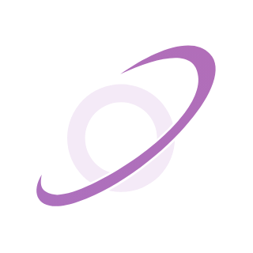

# Kosmos

[](https://www.python.org/)
[](https://docs.astral.sh/uv/)
[](#project-status)
[](LICENSE.md)
[](https://github.com/LS-PLuka/Kosmos-AI/actions/workflows/ci.yml)

Kosmos is a source-available, local-first personal AI assistant designed to automate tasks, interact with the operating system, assist developers, and orchestrate intelligent workflows through a unified desktop experience.

> Built around privacy, modularity, and extensibility, Kosmos aims to bring personal artificial intelligence directly to your machine.


## Overview

The project initially targets Ubuntu and is being built incrementally as a modular monolith. Local
processing is the default design direction; external providers must be explicit, replaceable
integrations rather than hidden requirements.

## Project status

**Stage 00 — Project Foundation is complete. Stage 01 — Core Engine is in development.** The
repository now includes the Stage 01.1 foundations for validated application settings, explicit
logging, text-inference models, and a replaceable asynchronous LLM provider contract. It does not
yet provide an operational AI assistant, a real model provider, an HTTP client, conversation
orchestration, voice, system control, persistent memory, automation, or a desktop application.

Everything described below as planned belongs to the roadmap and must not be interpreted as an
implemented capability.

## Vision

The long-term goal is a proactive desktop assistant inspired by integrated fictional assistants,
while remaining grounded in explicit authorization, transparent execution, privacy, and practical
software engineering. Kosmos should coordinate local intelligence, voice, operating-system tools,
development agents, memory, monitoring, automations, multimodal input, and plugins without making
the graphical interface or any external provider the center of the architecture.

## Planned capabilities

- Local model conversation, reasoning, and tool calling
- Wake word, speech recognition, and speech synthesis
- Operating-system, application, file, process, and Docker interaction
- Development-agent and project workflow integration
- Contextual and persistent memory
- Monitoring, reminders, notifications, and proactive automation
- Explicit permissions and security policies for tool execution
- Control Center, Overlay, and system tray desktop experiences
- External integrations, multimodal processing, and plugins

## Visual identity

The approved Dark Nebula identity uses the Void, Nebula, Cosmic, Nova, and Starlight palette. The
static identity, vector geometry, 12 motion states, reference data, and Motion Lab are preserved in
this repository.

| Institutional symbol | Kosmos Core | Motion example |
| --- | --- | --- |
|  |  |  |

See the [brand guide](docs/branding/BRAND-GUIDE.md), [motion assets](assets/branding/animations/),
and [Motion Lab](tools/motion-lab/). GIF and WebP files are documentation and approval references;
the future desktop implementation is planned to render approved vector geometry in real time.

## Architecture

Kosmos uses a modular monolith organized by business capability. Domain code should remain
independent of the graphical interface and frameworks. External services and system integrations
will be isolated behind adapters when a real substitution or testing need exists. Internal layer
directories are introduced only as modules acquire behavior, avoiding speculative abstractions.

The planned top-level domains are documented in
[the architecture overview](docs/architecture/README.md).

## Technology stack

Currently configured:

- Python 3.12 with a `src` layout
- uv for environments, dependency resolution, and locking
- Ruff for linting and formatting
- Pytest for automated tests
- Python standard-library configuration, logging, dataclasses, and asynchronous provider contracts
- GitHub Actions for continuous integration

Planned technologies, subject to evaluation and licensing review, include Ollama, Pydantic,
SQLite, openWakeWord, Silero VAD, faster-whisper, SoundDevice, Kokoro or Piper, psutil, Docker SDK,
Codex integration, PySide6, and Qt Quick/QML. None is a current runtime dependency.

## Roadmap

1. **Stage 00 — Project Foundation:** repository, tooling, standards, documentation, identity, CI
2. **Stage 01 — Core Engine:** local-model evaluation, Ollama, conversation, providers, tools
3. **Stage 02 — Voice Engine:** wake word, audio, VAD, speech-to-text, text-to-speech
4. **Stage 03 — System Control:** applications, files, processes, resources, Docker, OS integration
5. **Stage 04 — Developer Agent:** Codex, projects, sessions, tasks, execution tracking
6. **Stage 05 — Memory Engine:** context, preferences, persistence, retrieval
7. **Stage 06 — Proactive Engine:** events, monitoring, automations, reminders, notifications
8. **Stage 07 — Desktop Experience:** PySide6, QML, Control Center, Overlay, tray, vector motion
9. **Stage 08 — Extended Integrations:** AWS, Spotify, browser, productivity tools, services
10. **Stage 09 — Multimodal Engine:** webcam, computer vision, image and screen interpretation
11. **Stage 10 — Cross-platform & Ecosystem:** Windows, plugins, distribution, contributors

## Getting started

Install [uv](https://docs.astral.sh/uv/getting-started/installation/), then run:

```bash
uv python install 3.12
uv sync --frozen --dev
uv run python -c "import kosmos; print(kosmos.__version__)"
```

No application entry point or functional model integration exists in Stage 01.1.

## Development

```bash
uv sync --frozen --dev
uv run ruff check .
uv run ruff format --check .
uv run pytest
```

Ruff uses a 100-character line limit: wide enough for readable modern Python while still supporting
side-by-side review. See [the development guide](docs/development/README.md) and
[CONTRIBUTING.md](CONTRIBUTING.md).

To inspect the visual prototype without dependencies, open `tools/motion-lab/index.html` in a
modern browser. A local HTTP server may be used for optional microphone access as documented in
[the preserved package README](docs/branding/PACKAGE-README.pt-BR.md).

## Contributing

Read [CONTRIBUTING.md](CONTRIBUTING.md) before proposing a change. The contribution and future CLA
strategy is documented as a proposal pending maintainer and legal approval.

## License

Kosmos is source-available under the
[PolyForm Noncommercial License 1.0.0](LICENSE.md). Commercial use is not authorized by the standard
license except where its terms provide otherwise. A separate commercial license may be offered in
the future; none is granted here. Software licensing does not grant rights to use Kosmos names,
logos, or visual identity as trademarks.

## Acknowledgments

The repository uses uv, Ruff, Pytest, Hatchling, GitHub Actions, and the Contributor Covenant as
development or community infrastructure. Applicable notices are recorded in
[THIRD_PARTY_NOTICES.md](THIRD_PARTY_NOTICES.md).
