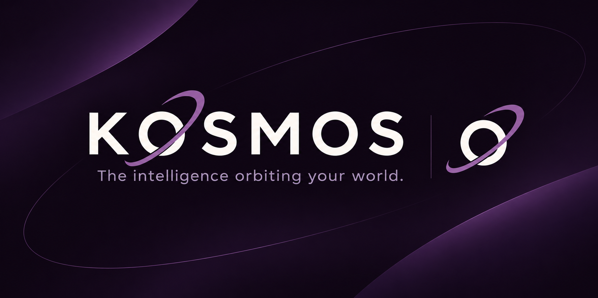
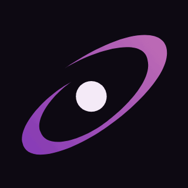

# Kosmos

[](https://www.python.org/)
[](https://docs.astral.sh/uv/)
[](#project-status)
[](LICENSE.md)
[](https://github.com/LS-PLuka/Kosmos-AI/actions/workflows/ci.yml)

Kosmos is a source-available, local-first personal AI assistant designed to automate tasks, interact with the operating system, assist developers, and orchestrate intelligent workflows through a unified desktop experience.

> Built around privacy, modularity, and extensibility, Kosmos aims to bring personal artificial intelligence directly to your machine.



## Overview

The project uses Ubuntu as its primary execution environment and Windows for portable development
and testing. It is being built incrementally as a modular monolith. Local processing is the default;
external providers must be explicit, optional, replaceable integrations rather than hidden
requirements.

## Project status

**Stage 00 — Project Foundation is complete. Stage 01 — Core Engine is in development.** The
repository includes the Stage 01.1 foundations and the Stage 01.2 Ollama HTTP adapter for complete
and streaming text inference. The adapter is automatically tested, but real inference on the
target Ubuntu host remains pending. Stage 01.3 provides automatically tested, in-memory
conversation sessions and context continuity and is integrated into `develop`.
Stage 01.4 provides an integrated provider-independent Personality Engine, with real behavioral
validation pending. Stage 01.5 integrates provider-independent tool contracts, deterministic
validation and authorization, two pure tools, and native non-streaming Ollama tool calling.
Stage 01.6 integrates bounded core orchestration and effort policies. Stage 01.7 provides an
automatically tested development CLI for later real Ubuntu and Qwen validation. Real model
validation remains pending. Kosmos does not provide voice, system control, persistent memory,
automation, or a desktop application.

Capabilities explicitly described below as planned belong to the roadmap and must not be
interpreted as implemented.

## Vision

The long-term goal is a proactive desktop assistant inspired by integrated fictional assistants,
while remaining grounded in explicit authorization, transparent execution, privacy, and practical
software engineering. Kosmos should coordinate local intelligence, voice, operating-system tools,
development agents, memory, monitoring, automations, multimodal input, and plugins without making
the graphical interface or any external provider the center of the architecture.

## Planned capabilities

- Local model conversation, reasoning, and tool calling
- Wake word, speech recognition, and speech synthesis
- Operating-system, application, file, process, and Docker interaction
- Development-agent and project workflow integration
- Contextual and persistent memory
- Monitoring, reminders, notifications, and proactive automation
- Explicit permissions and security policies for tool execution
- Control Center, Overlay, and system tray desktop experiences
- External integrations, multimodal processing, and plugins

## Visual identity

The approved Dark Nebula identity uses the Void, Nebula, Cosmic, Nova, and Starlight palette. The
static identity, vector geometry, 12 motion states, reference data, and Motion Lab are preserved in
this repository.

| Institutional symbol | Kosmos Core | Motion example |
| --- | --- | --- |
|  |  |  |

See the [brand guide](docs/branding/BRAND-GUIDE.md), [motion assets](assets/branding/animations/),
and [Motion Lab](tools/motion-lab/). GIF and WebP files are documentation and approval references;
the future desktop implementation is planned to render approved vector geometry in real time.

## Architecture

Kosmos uses a modular monolith organized by business capability. Domain code should remain
independent of the graphical interface and frameworks. External services and system integrations
will be isolated behind adapters when a real substitution or testing need exists. Internal layer
directories are introduced only as modules acquire behavior, avoiding speculative abstractions.

The intelligence design is hybrid and local-first: a local model interprets intent and coordinates
workflows, while deterministic software validates, authorizes, and executes operations. The
Ollama HTTP adapter is implemented with Qwen 3.5 4B as the initial external runtime model; real
inference validation on the target Ubuntu host remains pending. Remote providers and specialized
agents remain optional. Conversational sessions can receive deterministic Kosmos personality
instructions without coupling identity or behavior to a provider or model.

The planned top-level domains are documented in
[the architecture overview](docs/architecture/README.md), with details in the
[intelligence architecture](docs/architecture/INTELLIGENCE-ARCHITECTURE.md).

## Technology stack

Currently configured:

- Python 3.12 with a `src` layout
- uv for environments, dependency resolution, and locking
- Ruff for linting and formatting
- Pytest for automated tests
- HTTPX for asynchronous communication with the loopback-only Ollama API
- Python standard-library configuration, logging, dataclasses, and asynchronous provider contracts
- GitHub Actions for continuous integration

Ollama and Qwen 3.5 4B are external local-inference requirements and are not incorporated into the
repository. Other planned technologies, subject to their applicable evaluation and licensing
review, include Pydantic, SQLite, openWakeWord, Silero VAD, faster-whisper, SoundDevice, Kokoro or
Piper with the provisional Razo Brazilian Portuguese voice candidate, psutil, Docker SDK, Codex
and Claude Code integrations, PySide6, Qt Quick/QML, SearXNG,
Trafilatura, Beautiful Soup, Playwright, and the Google Gemini API.

## Roadmap

Stage 00 and Stage 01.1 — Core Foundation are complete. The Stage 01.2 — Ollama Provider adapter is
implemented and automatically tested; real Ubuntu inference validation remains pending.
Stage 01.3 — Conversation Engine, Stage 01.4 — Personality Engine, and Stage 01.5 — Tool Calling &
Tool Registry are integrated, with real personality and Qwen validation pending. Stage 01.6 — Core
Orchestration & Effort Levels is integrated and automatically tested. Stage 01.7 adds the
development CLI; real model validation follows as the separate Stage 01.8 substage. Later stages cover
voice, authorized system control, developer agents, memory, proactive intelligence, desktop,
web/external integrations, multimodal intelligence, and cross-platform ecosystem expansion.

See the [official roadmap](docs/architecture/ROADMAP.md) for the complete staged plan and status.

## Getting started

Install [uv](https://docs.astral.sh/uv/getting-started/installation/), then run:

```bash
uv python install 3.12
uv sync --frozen --dev
uv run python -c "import kosmos; print(kosmos.__version__)"
```

Run the development CLI after configuring a local Ollama installation and model:

```bash
uv run kosmos --help
uv run kosmos --list-models
uv run kosmos
```

Real Qwen validation on the target Ubuntu host remains pending.

## Development

```bash
uv lock --check
uv sync --frozen --dev
uv run ruff check .
uv run ruff format --check .
uv run pytest
git diff --check
```

Ruff uses a 100-character line limit: wide enough for readable modern Python while still supporting
side-by-side review. See [the development guide](docs/development/README.md) and
[CONTRIBUTING.md](CONTRIBUTING.md).

To inspect the visual prototype without dependencies, open `tools/motion-lab/index.html` in a
modern browser. A local HTTP server may be used for optional microphone access as documented in
[the preserved package README](docs/branding/PACKAGE-README.pt-BR.md).

## Contributing

Read [CONTRIBUTING.md](CONTRIBUTING.md) before proposing a change. The contribution and future CLA
strategy is documented as a proposal pending maintainer and legal approval.

## License

Kosmos is source-available under the
[PolyForm Noncommercial License 1.0.0](LICENSE.md). Commercial use is not authorized by the standard
license except where its terms provide otherwise. A separate commercial license may be offered in
the future; none is granted here. Software licensing does not grant rights to use Kosmos names,
logos, or visual identity as trademarks.

## Acknowledgments

The repository uses uv, Ruff, Pytest, Hatchling, GitHub Actions, and the Contributor Covenant as
development or community infrastructure. Applicable notices are recorded in
[THIRD_PARTY_NOTICES.md](THIRD_PARTY_NOTICES.md).
