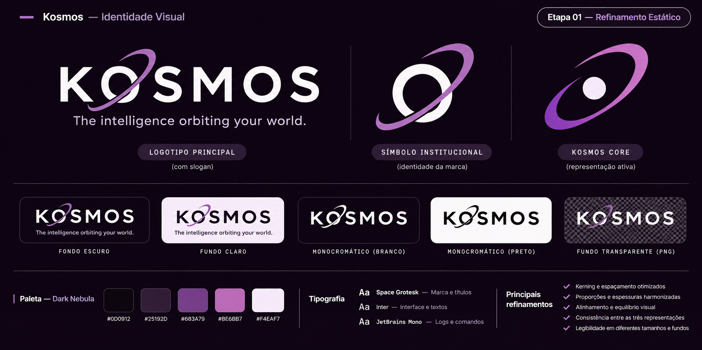

# Kosmos — Guia oficial de identidade visual

Versão de consolidação 1.0 · Fases A–D. As fases A–C e a prancha estática são referências aprovadas; as novas aplicações estáticas da fase D são propostas de consolidação, sujeitas à aprovação final.

## Conceito

Kosmos é um assistente pessoal de IA open source. Minimalismo cósmico: inteligência presente, atenta e responsiva; não um spinner. O nome textual é **Kosmos**; no logotipo, **KOSMOS**. Slogan: **The intelligence orbiting your world.** Tradução oficial: **A inteligência que orbita o seu mundo.**

## Recursos e aplicações

- Logotipo: `assets/branding/logos/kosmos-{dark,light,mono-white,mono-black}[-tagline].svg` e PNG correspondente (1404 px de largura). `dark` significa aplicação sobre fundo escuro, `light` sobre fundo claro. Todos têm fundo transparente. Use a versão sem slogan quando a largura for limitada. A geometria do lettering e slogan foi traçada a partir da prancha aprovada, sem substituir a fonte nem recalcular o kerning. Os contornos estáticos são polígonos vetoriais subpixel editáveis, não uma reconstrução tipográfica exata; a órbita do wordmark é a própria silhueta da prancha, não um substituto para a geometria aprovada do Overlay.
- Símbolo institucional: `symbols/institutional.svg` e PNG original, com anel vazado e órbita. Use para marca isolada, tray e Standby. Variantes light e mono preservam contornos e folga; são aplicações estáticas, nunca novos estados animados.
- Kosmos Core: `core/core.svg`, PNG 320 e 1024. Núcleo branco sólido e órbita. Use para representação ativa, não como substituto arbitrário da marca institucional.
- Ícones: 16, 24, 32, 48, 64, 128, 256, 512, 1024 px, fundo transparente; versões tray claras/escuras; favicon SVG/ICO; avatar GitHub e ícone de app com fundo Void. Ícones mantêm a margem do viewBox original; nenhum redesenho em dimensões pequenas.

## Dark Nebula

| Token | HEX | Uso |
|---|---|---|
| Void | #0D0912 | Fundo principal |
| Nebula | #25192D | Superfícies secundárias |
| Cosmic | #683A79 | Roxo profundo |
| Nova | #BE6BB7 | Destaques orbitais |
| Starlight | #F4EAF7 | Núcleo e lettering |

Gradientes aprovados do motor: institucional #AD70BD → #B16EB9; ativo #893DB7 → #BE6BB7. São nuances herdadas da prancha, não novos tokens. Na reconstrução do slogan escuro, #CDB6D6 aproxima o lavanda da prancha; no claro, Nebula. Monocromático preto usa #000000 apenas em recursos estáticos. Não aplicar verde, âmbar ou vermelho aos estados complementares.

## Tipografia

Space Grotesk para marca/títulos, Inter para interface/textos, JetBrains Mono para logs/comandos. O wordmark é arte fixa em curvas, não texto digitável; não se afirma identificação exata da fonte da imagem. Não empacotamos fontes.

## Espaçamento, dimensão e contraste

- Preserve proporções; escala uniforme, sem recorte da órbita. ViewBox do símbolo 320×320, centro de deformação (160,160). Não aparar a margem no Overlay.
- Área livre recomendada fora dos limites visuais: pelo menos 1/2 do diâmetro do núcleo ativo (~26 unidades no sistema 320). Para wordmark, margem de pelo menos 1/4 da altura das maiúsculas (~22 unidades do contorno estático). São recomendações de aplicação, não alterações de desenho.
- Tamanhos recomendados: símbolo institucional ≥32 px; tray/favicon 16–24 px são usos excepcionais e perdem detalhe da folga. Use mono conforme fundo. Overlay ≥64 px, preferencialmente 96–128 px; wordmark sem slogan ≥120 px; com slogan ≥280 px. Valores são recomendações a validar em telas físicas/DPI, não certificação de legibilidade.
- No Overlay, Starlight sobre branco ou Starlight tem contraste insuficiente. Preserve a cor e a transparência do símbolo, mas dê à superfície hospedeira uma pequena base Void/Nebula quando necessário. Sobre desktop, selecionar essa base por configuração ou tema; não introduzir contorno na geometria. Para marca estática use versão light/mono-black.

## Motion

| Estado | Tipo | Duração base | Comportamento |
|---|---|---:|---|
| Standby | Loop | 3200 ms | Respiração de até 0,8% do anel |
| Awakening | Transição | 1200 ms | Anel fecha, núcleo contrai, órbita morph |
| Listening | Loop/áudio | 4800 ms | Núcleo receptivo e expansão sensível à voz |
| Thinking | Loop | 3200 ms | Alternância das extremidades; núcleo estável |
| Executing | Loop | 1600 ms | Impulsos de expansão e espessura |
| Speaking | Loop/áudio | 4800 ms | Núcleo expressivo e órbita responsiva |
| Confirmation | Loop | 3600 ms | Expectativa; autorização externa explícita |
| Success | Evento | 1500 ms | Expansão e relaxamento |
| Notification | Evento | 1400 ms | Dois pulsos suaves |
| Warning | Híbrido | 2200 ms | Contração, pulsação, recuperação |
| Error | Híbrido | 2000 ms | Contração do núcleo e recuperação |
| Sleeping | Transição | 1200 ms | Inverso do Awakening |

Os tempos base não incluem entrada/saída do Lab ou pausa de apresentação nos arquivos. Core é pose neutra, não um 13º estado operacional. Sem rotação, partículas, hologramas, glitch, ícones de check ou alteração de orientação. Eventos devem aceitar interrupção e preservar pose. A voz real deve usar envelope normalizado, não GIF. Não confundir animação de confirmação com decisão de negócio.

## Usos incorretos

Não girar, esticar, recolorir, alterar tipografia/slogan, trocar o anel por galáxia, acrescentar brilho ou sombra ornamental, usar símbolo claro sem contraste, cortar as pontas, substituir animação vetorial por GIF em produção ou aplicar cor semântica externa nos estados. Os arquivos aprovados são rastreados em `approved-manifest.json`.
